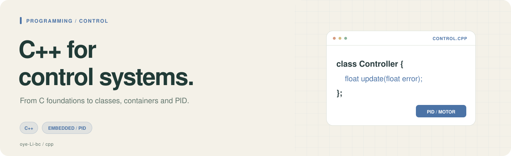
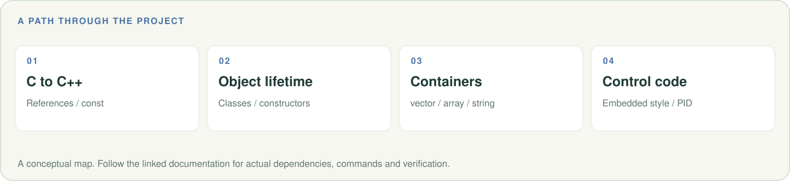

# C++ for Control

面向控制与嵌入式应用的 C++ 学习笔记，适合已有 C 语言基础、准备编写电机控制与 PID 代码的读者。

**[章节目录](#chapters) · [阅读建议](#reading) · [相关项目](#related)**

<picture>
  <source media="(max-width: 600px)" srcset=".github/readme/workflow-mobile.svg">
  
</picture>

## 章节目录

| 顺序 | 内容 |
|---|---|
| 00 | [总览 · 思维导图](00_%E6%80%BB%E8%A7%88_%E6%80%9D%E7%BB%B4%E5%AF%BC%E5%9B%BE.md) |
| 01 | [从C到C++的语法差异](01_%E4%BB%8EC%E5%88%B0C%2B%2B%E7%9A%84%E8%AF%AD%E6%B3%95%E5%B7%AE%E5%BC%82.md) |
| 02 | [引用与const](02_%E5%BC%95%E7%94%A8%E4%B8%8Econst.md) |
| 03 | [类与对象](03_%E7%B1%BB%E4%B8%8E%E5%AF%B9%E8%B1%A1.md) |
| 04 | [构造函数与析构函数](04_%E6%9E%84%E9%80%A0%E5%87%BD%E6%95%B0%E4%B8%8E%E6%9E%90%E6%9E%84%E5%87%BD%E6%95%B0.md) |
| 05 | [STL够用就行](05_STL%E5%A4%9F%E7%94%A8%E5%B0%B1%E8%A1%8C.md) |
| 06 | [嵌入式CPP风格](06_%E5%B5%8C%E5%85%A5%E5%BC%8FCPP%E9%A3%8E%E6%A0%BC.md) |
| 07 | [PID实战](07_PID%E5%AE%9E%E6%88%98.md) |
| 08 | [术语速查表](08_%E6%9C%AF%E8%AF%AD%E9%80%9F%E6%9F%A5%E8%A1%A8.md) |

## 阅读建议

按编号阅读语法差异、引用、类与生命周期，再进入 STL、嵌入式风格和 PID 实战。

这是以 Markdown 为主的学习资料仓库，阅读本身无需安装依赖。章节中的示例可单独练习，
具体工具、软件版本和硬件条件应按对应章节核对。

## 相关项目

- [ROS 课程工作空间](https://github.com/oye-Li-bc/lbc_ros_class_ws)
- [研究工作流 Skills](https://github.com/oye-Li-bc/research-workflow-skills)
- [个人作品集](https://oye-li-bc.github.io/)

封面与路线图均为可编辑 SVG；[图片说明](.github/readme/README.md)。
